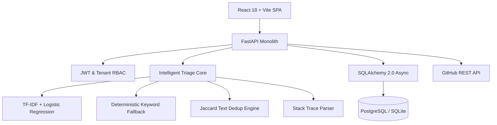

# Triage — Intelligent Bug Tracking & Engineering Routing Platform

[](docs/TESTING.md)
[](docs/TESTING.md)
[](docs/ARCHITECTURE.md)
[](LICENSE)

**Triage** is an intelligent bug tracking, categorization, and engineering workload-routing platform built for modern software teams. It provides developers, QA engineers, and engineering leads with a focused defect lifecycle management system powered by transparent machine learning and automated deduplication.

---

## Core Product Principles

1. **Strictly Single-Issue-First**: Every bug report is treated as a first-class engineering defect with dedicated deduplication, stack trace analysis, and human auditability. The platform contains **zero CSV or batch ingestion workflows**.
2. **AI-Assisted, Human-Controlled**: Machine learning assists engineers with intelligent routing suggestions, but humans retain full decision-making authority. Low-confidence predictions are automatically routed to a dedicated review inbox.
3. **Resilient Operational Architecture**: Core defect tracking remains fully functional even when machine learning artifacts are updating or unavailable.
4. **Engineering Usability**: Designed with the visual discipline, speed, and restraint of tools like Linear and GitHub Issues.

---

## Key Features

- **Individual Bug Reporting & Live Preview**: Real-time debounced classification previews, stack trace extraction, and token-similarity duplicate detection as you type.
- **Intelligent Routing & Uncertainty Engine**: Calibrated multiclass probabilities using TF-IDF and Logistic Regression, with normalized Shannon entropy uncertainty scoring.
- **Triage Review Inbox**: High-uncertainty predictions require lead engineer approval or override before final team assignment.
- **Defect Lifecycle & Collaboration**: Complete status state machine (`NEW`, `TRIAGE`, `IN_PROGRESS`, `FIXED`, `VERIFICATION`, `CLOSED`, `REOPENED`) with threaded engineering comments and immutable audit timelines.
- **Multi-Tenant Organizations & RBAC**: Tenant isolation across organizations, projects, and teams with role guards (`ORG_ADMIN`, `TEAM_LEAD`, `ENGINEER`, `VIEWER`).
- **Real Analytics & Telemetry**: Truthful database-backed issue distributions, resolution metrics, and Prometheus performance metrics (`/metrics`).
- **External Synchronization**: True GitHub Issues REST integration for syncing verified internal defects.

---

## System Architecture



---

## Quick Start (Local Development)

### 1. Prerequisites
- Python 3.11+
- Node.js 20+
- SQLite (included) or PostgreSQL

### 2. Backend Setup
```bash
# Clone repository
git clone https://github.com/Albert101255/bug-report-classifier.git
cd bug-report-classifier

# Create virtual environment
python -m venv venv
source venv/bin/activate

# Install dependencies
pip install -r requirements.txt -r requirements-dev.txt

# Run database migrations
alembic upgrade head

# Train baseline ML model from JSONL dataset
python scripts/train_baseline.py

# Launch FastAPI server
uvicorn app.main:app --app-dir backend --port 8000 --reload
```
API server will be live at `http://localhost:8000` (Interactive Swagger docs: `http://localhost:8000/docs`).

### 3. Frontend Setup
```bash
cd frontend

# Install dependencies
npm install

# Run Vite development server
npm run dev
```
Open `http://localhost:3000` in your browser.

---

## Production Deployment

### Docker Compose
Deploy the complete production stack (PostgreSQL, Redis, API, Nginx Frontend, Prometheus, Grafana):
```bash
cp .env.example .env
docker compose up -d --build
```

### Kubernetes
Apply production manifests with secret key references:
```bash
kubectl apply -f k8s/secrets.example.yaml
kubectl apply -f k8s/deployment.yaml
kubectl apply -f k8s/service.yaml
```

---

## Automated Verification & Testing

### Backend Unit & Integration Tests (19 tests)
```bash
./venv/bin/pytest backend/tests/ tests/ -v
```

### End-to-End Browser Journeys (Playwright)
```bash
cd frontend
npm run build
npx playwright test
```

---

## Documentation Index

- [Rebuild Audit & Technical Debt Inventory](docs/REBUILD_AUDIT.md)
- [System Architecture & Data Model](docs/ARCHITECTURE.md)
- [API Reference & OpenAPI Specification](docs/API_DOCS.md)
- [Production Deployment & Kubernetes Guide](docs/DEPLOYMENT.md)
- [Security Architecture & RBAC](docs/SECURITY.md)
- [Automated Testing Strategy](docs/TESTING.md)
- [Machine Learning Model Evaluation & Methodology](docs/ML_EVALUATION.md)
- [Architecture Decision Records (ADRs)](docs/DECISIONS.md)

---

## License

This project is licensed under the MIT License - see the [LICENSE](LICENSE) file for details.
