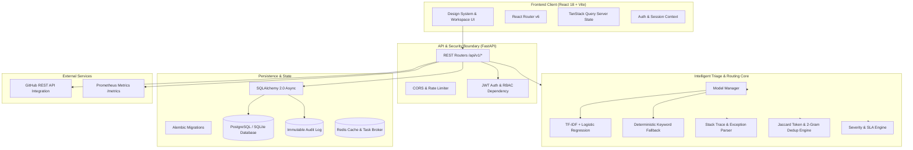
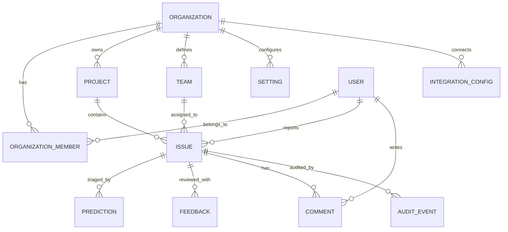
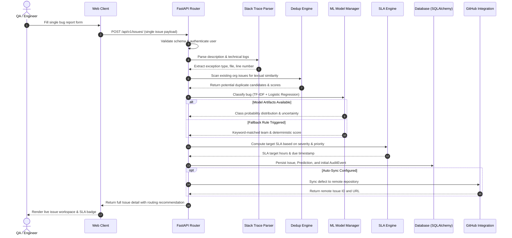

# System Architecture & Technical Design

## 1. Executive Overview

**Triage** is an enterprise-grade engineering issue tracking, intelligent triage, and workload routing platform. It replaces manual bug assignment with an assisted routing engine that evaluates bug reports individually, assesses team ownership, calculates priority and SLAs, detects duplicates, parses technical stack traces, and provides human leads with an audited review loop.

The system is strictly **single-issue-first**. Batch uploads, CSV processing pipelines, bulk classification routes, and multi-issue ingestion wizards have been eliminated to guarantee consistency, auditability, and immediate human oversight for every reported software defect.

---

## 2. High-Level Architecture Diagram

---

## 3. Core Domain Entities & Multi-Tenancy

Every resource in Triage belongs to a tenant organization, enforcing multi-tenant isolation across all query boundaries.

### Entity Definitions
1. **Organization (`organizations`)**: Top-level tenant container. Provides administrative boundary, custom triage policies, and member access.
2. **User (`users`)**: Authenticated engineer with bcrypt password hash, role (`ORG_ADMIN`, `TEAM_LEAD`, `ENGINEER`, `VIEWER`), and active status.
3. **Project (`projects`)**: Engineering project workspace (e.g. `Main Platform` with prefix `TRIAGE`). Issues receive monotonic keys (`TRIAGE-1`, `TRIAGE-2`).
4. **Team (`teams`)**: Engineering domain team with distinct ownership code (`BL-101` Auth, `BL-102` Database, etc.).
5. **Issue (`issues`)**: The core defect record. Contains title, description, steps to reproduce, technical logs, priority, severity, status state machine, assigned team, and SLA targets.
6. **Prediction (`predictions`)**: Immutable record of single-issue ML inference, capturing predicted team, confidence score, uncertainty score, engine used, execution latency, and review status.
7. **Feedback (`feedbacks`)**: Human review record capturing whether the ML recommendation was approved or overridden, with target team and justification.
8. **AuditEvent (`audit_events`)**: Comprehensive audit trail capturing state transitions, assignments, overrides, and integrations.

---

## 4. Single-Issue Ingestion & Triage Pipeline

When an engineer or external webhook submits an individual bug report, the pipeline executes synchronously within the request lifecycle:

---

## 5. Machine Learning & Intelligent Routing Engine

### Architecture
- **Model Pipeline**: `scikit-learn` Pipeline featuring `TfidfVectorizer` (sublinear TF scaling, n-grams 1-2, English stopword pruning) followed by `LogisticRegression` with multi-class multinomial loss and L2 regularization.
- **Artifact Versioning**: Model weights (`model.joblib`), vectorizer vocabulary (`vectorizer.joblib`), label encoder classes (`label_encoder.joblib`), and training metadata (`metadata.json`) stored on disk and dynamically reloaded on timestamp change.
- **Confidence & Uncertainty Calculation**:
  $$\text{Confidence} = \max_{c} P(y = c \mid x)$$
  $$\text{Uncertainty} = 1 - \text{Confidence}$$
  Normalized Shannon entropy is also logged for detailed telemetry:
  $$H(x) = -\frac{1}{\ln(K)} \sum_{k=1}^K p_k \ln(p_k)$$
- **Triage Threshold Routing**:
  - High Confidence ($\ge 0.25$ by default, configurable): Automated routing to recommended team when auto-assign is enabled.
  - Low Confidence / High Uncertainty ($> 0.50$): Automatically marked as `PENDING` review and routed to the **Triage Review Inbox** for human engineer sign-off.
- **Deterministic Keyword Fallback**: If model weights are missing or undergoing retraining, the keyword engine deterministically maps specialized terminology (e.g., `postgresql`, `auth0`, `k8s`, `stripe`, `react`) to responsible teams.

---

## 6. Duplicate Detection Engine

- Text preprocessing extracts non-stopword alphanumeric tokens and character 2-grams from title and description.
- Computes Jaccard similarity between incoming defect and active open issues within the same project.
- Flags matches exceeding threshold (default $0.22$) directly in the triage banner to prevent redundant work.

---

## 7. Frontend Architecture

- **SPA Framework**: React 18 in strict mode with Vite build system.
- **Styling**: Tailwind CSS with custom design tokens, dark and light mode support, accessible high-contrast palettes, and zero demo gradients.
- **Server State**: TanStack Query v5 with optimistic updates and background cache revalidation.
- **Routing**: React Router v6 with declarative protected layout routes.
- **Client Reliability**: Pure API communication via `frontend/src/api.ts` with zero fake fallbacks or browser-side mock heuristics.
