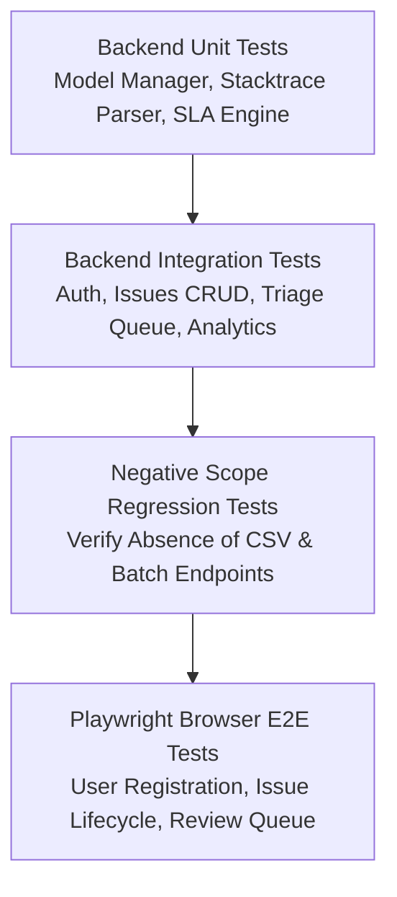

# Automated Testing & Verification Guide

## 1. Testing Philosophy

The Triage platform employs a multi-tiered automated testing strategy designed to verify real enterprise behaviors, prevent regression of obsolete workflows, and ensure complete reliability across UI and API surfaces.



---

## 2. Backend Automated Tests (Pytest)

The backend test suite is located in `backend/tests/` and root `tests/`. It runs asynchronously using `pytest` and `pytest-asyncio`.

### Test Coverage
- `test_auth.py`: Registration, login, duplicate user rejection, password hashing, and token validation.
- `test_issues.py`: Issue creation, project scoping, status state machine transitions, commenting, and audit trail logging.
- `test_triage.py`: Single issue `/predict` preview, review queue fetching, prediction approval, and prediction override.
- `test_analytics.py`: Database-backed metrics calculation, ensuring zero fabricated or hard-coded constants.
- `test_model_manager.py`: TF-IDF feature extraction, Logistic Regression inference, confidence bounds, and keyword fallback.
- `test_negative_scope.py`: Verifies that `/api/v1/predict/batch`, `/api/v1/issues/import`, and batch endpoints are absent and return `404` or `405`.
- `tests/test_api.py`: Core health check and API regression tests.

### Running Backend Tests
```bash
./venv/bin/pytest backend/tests/ tests/ -v
```

---

## 3. End-to-End Browser Tests (Playwright)

End-to-end user journeys are automated using Playwright with headless Chromium.

### Test Suite: `frontend/e2e/enterprise_triage.spec.ts`
1. **01: Auth & Workspace Setup**: Registers a new user, creates an engineering organization, and lands on the Overview dashboard.
2. **02: Negative Scope Verification**: Asserts that navigation contains no references to "Batch", "CSV", "Bulk", or "Import", and verifies that direct navigation to `/batch-upload` redirects cleanly.
3. **03: Single Issue Creation with Intelligent Triage**: Submits a real defect with stack traces, verifies live recommendation preview, and validates persisted routing details.
4. **04: Issue Lifecycle & Team Collaboration**: Transitions issue state to `IN_PROGRESS`, posts engineering comments, and asserts they appear in the thread.
5. **05: Triage Review Queue**: Validates that low-confidence/uncertain issues populate the review inbox.
6. **06: Settings & Governance**: Updates triage thresholds and verifies persistence after page reload.

### Running Playwright Tests
Ensure the backend and frontend preview servers are running:
```bash
cd frontend
npm run build
npx playwright test
```
